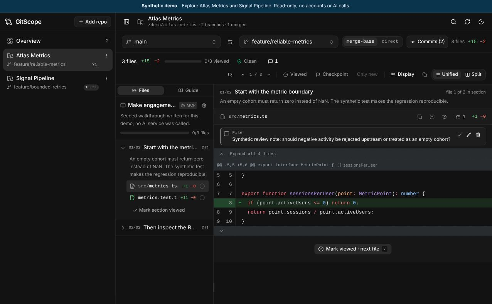
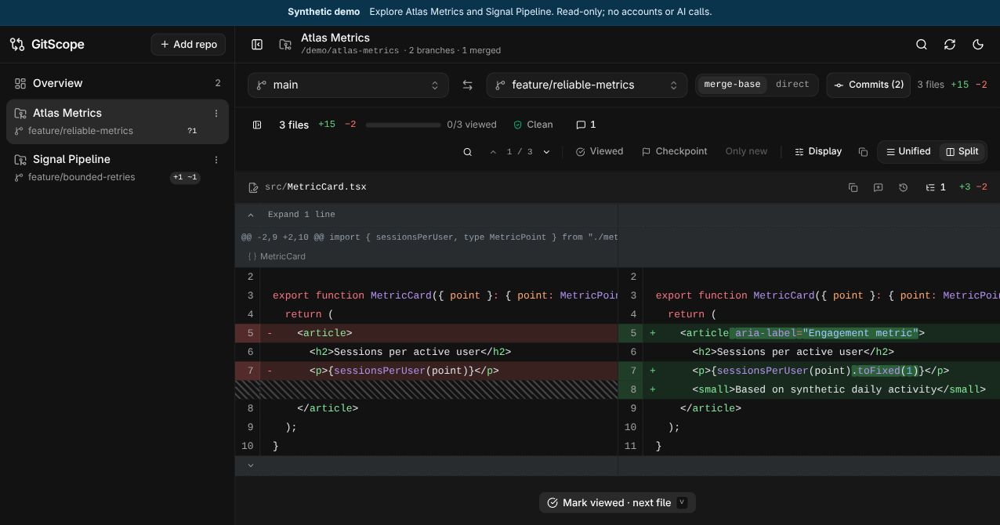
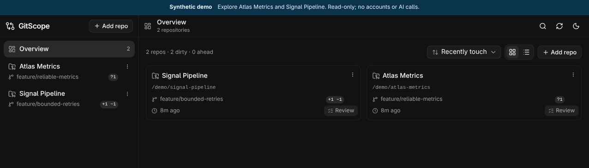
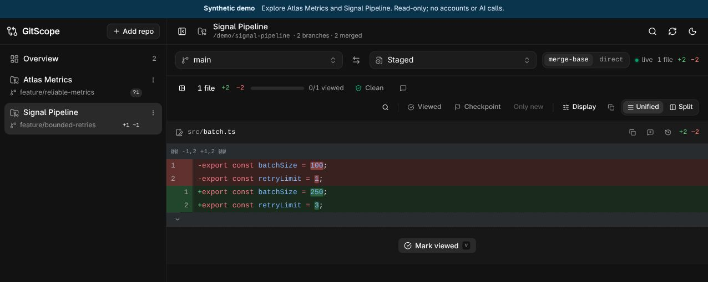
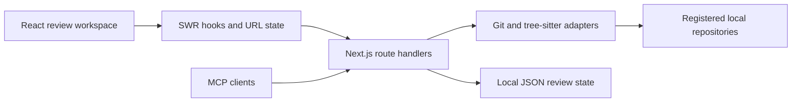

# GitScope

**A local code-review workspace for understanding changes across repositories.**

GitScope turns Git patches into a navigable review interface: compare branches or
uncommitted work, inspect symbols and references, follow a guided reading order,
and track review notes without opening a pull request first.

Built with **React 19, TypeScript, Next.js 16, SWR and Tailwind CSS**. The server
reads local Git repositories; the browser handles navigation, review state and
diff presentation. It is a single-user developer tool, not a hosted Git service.



*Actual application capture: a synthetic regression, a seeded reading guide and a review note.*

## Try the synthetic demo

Requirements: Node.js 22.13 or later, Git, and Bun 1.3 or later.

```sh
bun install --frozen-lockfile
bun run build
bun run demo
```

Open the local URL printed by the launcher (port `3417` by default). No account,
API key, GitHub connection or AI subscription is needed. The build uses system
fonts and does not fetch fonts from an external provider.

The launcher creates fresh, disposable repositories under `.demo/` and uses a
separate state directory. It does not read the normal GitScope registry.
Repository registration, review writes, MCP and AI execution are disabled in this
mode. All records, authors, commits, notes and guides are synthetic.

**Two-minute walkthrough:**

1. Open **Atlas Metrics** and compare `main` with `feature/reliable-metrics`.
2. Inspect `src/metrics.ts`: a zero-user cohort previously produced `NaN`.
3. Read the regression test and React metric-card changes. Switch between split
   and unified views, search the diff, and open the symbol outline.
4. Open **Guide** for a seeded reading order and **Notes** for a sample review
   question. The guide is fixture content, not a recorded live model response.
5. Return to the dashboard, open **Signal Pipeline**, and select **Staged** in
   the right-hand comparison picker to inspect its pending changes.

Set `GITSCOPE_DEMO_PORT=3420` if the default port is occupied. Restarting creates a
fresh demo; old `.demo/run-*` directories can be removed after their server stops.


## Inside the workspace

### Compare React changes



### Track repositories and staged work





These are captures of the running app with invented repositories and code. Crops
remove unused space; the interface and review results are not rendered mockups.

## What this project demonstrates

This is Lucas Muller's personal developer-tool portfolio project. Its principal
engineering contributions are the review workflow and implementation around Git:

- A typed contract connecting server-side Git operations, route handlers and a
  React interface, with loading, empty, invalid-reference and truncated-diff states.
- URL-backed comparison state, persistent per-repository preferences, keyboard
  navigation, and an inbox for reviewing work across repositories.
- Unified and split rendering, syntax highlighting, image comparisons, blame,
  context expansion, incremental rendering and symbol/reference navigation.
- Branch-scoped review notes, content-based anchors, review checkpoints and
  structured reading guides for human/agent handoffs.
- A validated MCP interface with an integration test using the official SDK.

Development used AI coding assistance. GitScope builds on third-party libraries
and generated UI primitives; it does not claim authorship of React, Next.js, Git,
shadcn/ui, parsers or syntax grammars. The showcase includes synthetic fixtures, isolated demo execution, portable
configuration and reproducible validation commands.
See [provenance](docs/PROVENANCE.md) for the source snapshot and review boundaries.

## Architecture



| Concern | Implementation | Trade-off |
| --- | --- | --- |
| Shared contract | `src/lib/types.ts` | Explicit types at UI/API boundaries |
| Git access | `src/lib/git.ts`, `simple-git` | Requires installed Git and local filesystem access |
| Rendering | `src/components/diff/` | Whole-hunk incremental rendering, not full virtualization |
| Navigation | `src/lib/url-state.ts`, `src/lib/comparison.ts` | Deep links follow refs unless pinned to commits |
| Refresh | SWR and `/api/repos/[id]/watch` SSE | Local filesystem watching; single-user assumptions |
| Review state | JSON files under `GITSCOPE_CONFIG_DIR` | No database; no multi-process write coordination |
| Code intelligence | Tree-sitter WASM and Git-based reference search | Structural heuristics, not a language-server type graph |
| Agent handoff | `/api/mcp`, review guides and notes | Optional; local access must be trusted |

See [the API contract](CONTRACT.md) and [MCP setup](docs/mcp.md).

## Use with your own repositories

```sh
bun run dev                  # http://127.0.0.1:3000
# Or, after building:
bun run start
```

Use **Add repository** and select an existing local checkout. The default registry
and review state live in `~/.config/gitscope`; `GITSCOPE_CONFIG_DIR` overrides that
location. See [`.env.example`](.env.example) for optional settings.

Normal mode can read registered source files and write review metadata. Optional
GitHub badges use the authenticated `gh` CLI. Optional AI review and guide
creation invoke a configured local AI CLI and may send the selected code to its
provider. These features are user-triggered and are not used by the demo.

Keep the server on loopback or a trusted private network. There is no in-app
multi-user authentication. **Do not deploy this server as a public portfolio
website.** Public source distribution and public hosting are separate decisions;
a hosted showcase would need a separate, restricted design.

## Verification

```sh
bun run lint
bun run typecheck
bun run test:demo             # fixture isolation, Git history and metric regression
bun run build
bun run test:mcp              # production server + isolated SDK integration
bun run test:demo-http        # production demo API and isolation guards
```

The integration tests use temporary repositories and state, then clean them up.
They do not modify the normal registry. Default test ports are `3307` and `3418`;
override with `GITSCOPE_TEST_PORT` and `GITSCOPE_DEMO_TEST_PORT` when necessary.
They require a production build. [Validation notes](docs/VALIDATION.md) distinguish
checks actually run from remaining limitations.

## Scope and limitations

- Local, single-user operation; no authentication, hosted collaboration or sync.
- Optional AI/PR features depend on separately installed and authenticated CLIs.
- Automated preflight findings are heuristic; they cannot certify a repository
  or its history as free of credentials or confidential data.
- The sample analytics numbers are invented and do not describe any real product.
- Demo mode is for local evaluation, not a security boundary for public hosting.

## License

Original GitScope code: [MIT](LICENSE), Copyright (c) 2026 Lucas Muller.
Third-party components retain their own terms; see
[third-party notices](THIRD_PARTY_NOTICES.md) and the
[dependency inventory](docs/THIRD-PARTY.md).
